# OCR + Fraud Detection handoff

The OCR AI engineer owns invoice/PO extraction, OCR injection defence and explainable document fraud signals. Work is on `ocr/evidence-fraud-graph`, [core PR #16](https://github.com/Khawpuneiei/ReceivableOS/pull/16). The core service, tests and four demo PDFs are separate from the optional corpus/evidence on `ocr/corpus-evidence`, [draft companion PR #39](https://github.com/Khawpuneiei/ReceivableOS/pull/39). Review the core first; the companion targets the core branch and can be retargeted to main after core merge. Scripts regenerate JSON reports locally; generated reports are not committed.

```mermaid
flowchart LR
    Upload[PDF / PNG / JPEG] --> Guard[Bounded signature and MIME checks]
    Guard --> Parse[Isolated parser: raw SHA-256, text, images, QR, metadata]
    Parse --> Rules[Spatial fields and explicit item tables]
    Parse --> Injection[Hidden, tiny, off-page, Unicode, QR instructions]
    Parse --> Paddle[Optional staged Paddle for unreadable pages]
    Paddle --> Rules
    Parse --> Vision[Optional local Qwen or opted-in hosted candidates]
    Vision --> Validate[Grounding, disagreement, Decimal/date/currency validation]
    Rules --> Validate
    Injection --> Validate
    Validate --> PO[Optional separately uploaded PO comparison]
    PO --> History[Bounded SQLite observations and HMAC tokens]
    History --> Fraud[Duplicates, arithmetic, PO mismatches, bank signals, graph]
    Fraud --> Output[ExtractedInvoice + evidence, review status, unsigned handoff]
    Output --> Policy[Policy owner: approve / review / reject]
    Policy --> Wallet[Wallet owner: guarded execution]
```



OCR returns evidence, not a financing decision. It does not verify issuer authenticity, delivery, tax registration, bank ownership, settlement, remaining PO capacity or prior financing at other lenders. Fraud scores are uncalibrated rule aggregations, not probabilities.

Core release validation: **184 OCR tests passed / 1 optional publisher-fixture skip**, both locally and in a fresh clone. The history-context follow-up passes **196 tests / 1 skipped** and strict demo **7/7**, with zero Policy control violations. The companion regressions pass **13/13**; Policy passes **251/3 skipped** and Wallet **122/2 skipped**. Release checks pass for the OCR scope. Current full-flow funding remains blocked at Wallet as described below.

## Start and test

From the repository root, Python 3.11+:

```bash
python3.11 -m venv services/ocr-ai/.venv
services/ocr-ai/.venv/bin/python -m pip install -r services/ocr-ai/requirements-dev.txt
services/ocr-ai/.venv/bin/python services/ocr-ai/scripts/setup_local.py
services/ocr-ai/.venv/bin/python services/ocr-ai/datagen/generate.py --output data/invoices/generated --font data/invoices/fonts/NotoSansThai-Regular.ttf
PYTHONPATH=. services/ocr-ai/.venv/bin/python -m uvicorn app.main:app --app-dir services/ocr-ai --env-file services/ocr-ai/.env.local --host 127.0.0.1 --port 8001
```

Setup creates ignored `.env.local` with private random `FINGERPRINT_HMAC_KEY`, `BANK_TOKEN_HMAC_KEY` and `OCR_RESULT_ACCESS_TOKEN`, mode 0600; existing configuration is preserved. It disables hosted/local models. Keep keys stable across restarts and consumers. Root `.env.example` now includes `BANK_TOKEN_HMAC_KEY` alongside the fingerprint key, as requested in review. Use the service setup or supply **both** HMAC keys explicitly. This is the sole one-line root configuration change; shared schemas and other services are unchanged.

For a fictional **development-only no-key** run, including the PM's unchanged default text demo:

```bash
OCR_DEVELOPMENT_MODE=1 PYTHONPATH=. services/ocr-ai/.venv/bin/python -m uvicorn app.main:app --app-dir services/ocr-ai --host 127.0.0.1 --port 8001
# After starting the other services with mock chain settings:
services/ocr-ai/.venv/bin/python services/orchestrator/run_demo.py
```

Development mode supplies separate public fallback HMAC keys for missing settings and warns once per setting. Default `OCR_DEVELOPMENT_MODE=0` requires configured keys and returns 503 when they are unavailable. Never use public demo keys for real records. The exact original `data/invoices/demo_invoice.txt` bytes are allowlisted only on `/ocr/extract` in development mode; modified/arbitrary text returns 415. Its printed fields are extracted with source text offsets and raw-byte hash. Missing jurisdiction, SKU and unit evidence remains unknown, so this legacy sample goes to review. The PM owns the future change of the orchestrator default to PDF.

```bash
services/ocr-ai/.venv/bin/python -m pytest services/ocr-ai -q -p no:cacheprovider
services/ocr-ai/.venv/bin/ruff check services/ocr-ai
services/ocr-ai/.venv/bin/ruff format --check services/ocr-ai
services/ocr-ai/.venv/bin/python -m pip check
services/ocr-ai/.venv/bin/python services/ocr-ai/scripts/demo_order.py
# Install peer dependencies before the cross-service loop:
services/ocr-ai/.venv/bin/python -m pip install -r services/ocr-ai/requirements-integration.txt
services/ocr-ai/.venv/bin/python services/ocr-ai/scripts/demo_loop.py --strict --skip-fraud-eval
services/ocr-ai/.venv/bin/python services/ocr-ai/scripts/eval.py
services/ocr-ai/.venv/bin/python services/ocr-ai/scripts/benchmark_cache.py
# Complete release check, with fresh clone/environment:
services/ocr-ai/.venv/bin/python services/ocr-ai/scripts/release_check.py --fresh --strict
```

Reports are generated under `services/ocr-ai/docs/*.json` and ignored by Git. Regression corpora are generated in temporary directories and removed automatically. One publisher-fixture regression is explicitly skipped when the optional corpus is absent; it runs on the companion checkout. The licensed Thai font is retained because core Thai regressions use it.

## API and data

| Endpoint | Input / behavior |
|---|---|
| `GET /health` | Liveness: `{"status":"ok","service":"ocr-ai"}`; does not imply model readiness |
| `POST /ocr/extract` | Multipart `file`: signature-verified PDF, PNG or JPEG, up to 10 MiB; returns shared `ExtractedInvoice` plus extras. Required unresolved fields → 422 |
| `POST /ocr/verify` | Multipart `invoice_file`, `po_file`: independently grounded comparison; match / mismatch / unknown |
| `POST /ocr/cases/verify` | JSON `manifest` form field and repeated `files`: at most 12 documents / 20 MiB combined; limited English supporting templates |
| `GET /ocr/invoices/{id}` | `X-OCR-Result-Token` matching `OCR_RESULT_ACCESS_TOKEN`; bounded process-local results, 15-minute TTL |
| `POST /ocr/llm/prewarm` | Same access token and multipart `file`; warms enabled model caches without adding observations |

```bash
curl -sS -F file=@data/invoices/demo/01_happy.pdf http://127.0.0.1:8001/ocr/extract
# Generate the matching PO with datagen/generate.py first:
curl -sS -F invoice_file=@data/invoices/demo/01_happy.pdf -F po_file=@data/invoices/generated/demo/purchase_order.pdf http://127.0.0.1:8001/ocr/verify
```

Money is `Decimal`, serialized as decimal strings; dates are ISO 8601. `doc_hash` hashes original bytes. Registry-v1 HMAC fingerprint rules are in [CLAUDE.md §8.4](CLAUDE.md#84-doc_hash-and-invoice_fingerprint). Local semantic identity and bank tokens have separate namespaces. Numeric runs lose leading zeros **before** reference separators are removed.

Optional `Idempotency-Key` binds observation history to route and bytes: identical retry does not create duplicate observations; changed bytes under the same key → 409. Parser limits: five PDF pages, 12M pixels/page, 200k text characters, 20-second parser timeout. Two processing slots per process; saturation → 429. History holds 500 observations and fails at capacity rather than discarding duplicate evidence.

The additive response includes grounded `document_evidence`, `validation_flags`, `review_required`, `fraud_details`, finding-scoped `fraud_graph`, an unsigned `handoff` and `model_checks`. Raw bank accounts are transient; SQLite, graph IDs and public responses contain scoped HMAC tokens rather than account values. These endpoints assume a trusted local MVP environment; operator result tokens are not tenant authentication.

## Four-file demo

| File | Expected Policy guard | Evidence |
|---|---|---|
| `01_happy.pdf` | approve if profiles and other Policy rules permit | Confidence 0.97, fraud 0.00 in isolated state |
| `02_injected.pdf` | review | Visible instruction flag, confidence 0.79; printed values remain intact |
| `03_inflated.pdf` | reject | Arithmetic inconsistency, fraud 0.40 |
| `04_duplicate.pdf` after 01 | reject | Cosmetic re-save: different raw hash, identical fingerprint, fraud 0.80 |

Exact-byte duplicate detection is tested separately: both duplicate flags, score 0.96. The ordered demo uses temporary isolated state. Normal service state persists: rehearse against fresh demo state or explicitly reset **demo** history, otherwise a repeat happy invoice correctly becomes a duplicate.

To reset fictional demo history only, stop the OCR server and run from `services/ocr-ai`:

```bash
OCR_DEVELOPMENT_MODE=1 OCR_ALLOW_RESET=1 PYTHONPATH=../.. .venv/bin/python -c 'from app.config import Settings; from app.history import ObservationStore; s=Settings.from_env(); ObservationStore(s.state_path).reset(development_mode=s.development_mode, allow_reset=s.allow_reset)'
```

Use the same `OCR_STATE_PATH` as the server. Reset is an operator Python capability, never an HTTP endpoint. Fingerprint normalization changed in this review; existing demo observations made with the old reference algorithm should be reset before rehearsal. Live history requires a reviewed migration.

History now binds its stored identities to an opaque digest of both HMAC-key settings and the
identity recipe version. A key or recipe change, or an existing populated database with no
binding, returns **503 requiring operator migration** rather than treating old identities as
different suppliers/invoices. Empty databases bind on the first write. Keys and raw accounts
are not stored in the binding. Choose keys before populating demo state; switching from public
dev keys to generated private keys also requires fresh demo state or the explicit reset above.
Never reset live history to work around this response: preserve it and arrange a reviewed
migration/re-extraction with the owners. Automatic live migration is not implemented.

## Models and performance

PDF text/layout is preferred. Optional PaddleOCR handles unreadable pages with explicitly staged assets. English is primary; Thai scan accuracy has gaps and Simplified Chinese is experimental/review-only. There is no automatic language router. Qwen and hosted vision produce strict nullable candidates; they cannot replace or invent grounded fields. Disagreement, alert or reader failure requires review.

```bash
services/ocr-ai/.venv/bin/python -m pip install -r services/ocr-ai/requirements-ocr.txt
services/ocr-ai/.venv/bin/python services/ocr-ai/scripts/stage_paddle.py
ollama pull qwen3-vl:4b-instruct
# Start Ollama separately; enable staged local readers explicitly:
OCR_PADDLE_ENABLED=1 OCR_QWEN_ENABLED=1 PYTHONPATH=. services/ocr-ai/.venv/bin/python -m uvicorn app.main:app --app-dir services/ocr-ai --env-file services/ocr-ai/.env.local --host 127.0.0.1 --port 8001
```

Hosted Anthropic image upload requires **both** `OCR_HOSTED_VISION_ENABLED=1` and configured `LLM_PROVIDER=anthropic`, `LLM_MODEL`, `LLM_API_KEY`. A key alone never enables it. Images leave the machine only on this opted-in path. Successful candidates are cached in RAM (128 entries, 4 MiB, 15 minutes); no model document cache is persisted. Prewarm the actual single-worker instance immediately before demo. Restart loses warming; failures are not cached.

Cache misses are deduplicated per document key for hosted and Qwen readers. Different keys no longer wait behind another request's network call. A mocked two-request benchmark with 0.25-second latency per call measured **0.518 → 0.258 seconds** after the fix; this measures lock contention, not live model inference performance. Local Paddle still initializes in an isolated worker per request; no unmeasured persistent model server has been introduced.

## Integration limits and handoff

Policy accepts the shared invoice projection and applies its own guards: fraud ≥0.30 → reject; injection or confidence <0.80 → review. The actual local Policy implementation is exercised in `demo_loop.py`; PO/case/graph adoption still needs a separately reviewed PM contract. Shared schemas, Policy, Wallet and orchestrator code are unchanged. Main at `7d46da5` now includes the Wallet implementation. The loop exercises its mock-ledger response; The current clean run is `Policy approve → Wallet blocked / SchemaInvalid`: the PM-owned orchestrator sends the old execute payload without required fingerprint/intent bindings, and does not run Registry registration / credit approval. PM must wire those lifecycle steps and fields before claiming successful drawdown. OCR does not bypass those guards or prove real settlement.

Read the [2026-10-11 Progression Update](docs/PROGRESSION_UPDATE_2026-10-11.md) for follow-up PRs, confirmed CI results and remaining team dependencies. Also read [review fixes and validation](docs/REVIEW_FOLLOWUP.md), [architecture](docs/ARCHITECTURE.md), [consumer handoff](docs/HANDOFF.md), [document coverage](docs/DOCUMENT_CATALOG.md), [fraud rules](docs/FRAUD_VALIDATION.md), and [Policy handoff](docs/POLICY_INTEGRATION_HANDOFF.md). Broader experimental findings and attributed external data are in the companion corpus/evidence PR. The external synthetic development set remains below the global accuracy target; an independent vendor holdout, confirmed fraud labels and live hosted-model validation remain outstanding.
