# OCR-owned invoice and PO verification

This README is the handoff entry point for the OCR AI engineer's scope on branch `ocr/evidence-fraud-graph`. It covers invoice/PO OCR, document injection defence, source-grounded cross-document checks, and explainable fraud evidence. OCR prepares evidence for Policy and Wallet; it does not approve financing, authorize payment, or decide that a document is authentic. Shared schemas and other service owners' code remain unchanged.

## Handoff status — 11 October 2026

The OCR-owned implementation and automation are in place for review. The latest checked-in demo sequence is deliberately ordered and separates the four decisions: `01_happy.pdf` is an approve candidate, `02_injected.pdf` requires review, `03_inflated.pdf` is rejected for inconsistent math, and `04_duplicate.pdf` is rejected as an exact and semantic duplicate of 01. Cases 02 and 03 have distinct invoice numbers so the injection case does not accidentally trigger the duplicate rules. The local evidence-gate replay passes all four expectations; the live downstream Policy stub still violates two hard guards by approving the injected and inflated invoices. That downstream gap remains visible in `docs/DEMO_LOOP_RESULTS.json` and the release report.

```mermaid
flowchart LR
    Upload[PDF / PNG / JPEG] --> Guard[Size, MIME, signature checks]
    Guard --> Parse[Isolated parser: SHA-256, text, page images, metadata, QR]
    Parse --> Detect[Hidden / tiny / off-page / Unicode / QR injection signals]
    Parse --> OCR[PDF text first; PaddleOCR for scan pages]
    OCR --> Rules[Rules extract fields with source locations]
    Parse --> Vision[Optional local Qwen-VL or hosted Anthropic candidate]
    Vision --> Compare[Strict schema + disagreement / failure review]
    Rules --> Compare
    Detect --> Review[Confidence, validation and review reasons]
    Compare --> Review
    Review --> Match[Invoice ↔ PO and supporting-document checks]
    Match --> Fraud[Duplicate, amount, identity and graph risk rules]
    Fraud --> JSON[Typed OCR result + JSON evidence / unsigned handoff]
    JSON --> Policy[Policy owner: approve / review / reject]
    Policy --> Wallet[Wallet / security owner: guarded execution]
```



The processing order protects source evidence: parsers inspect private document content; deterministic rules own the values and their page/bounding-box evidence; vision models return nullable proposals that can trigger a review but cannot overwrite rules output. Injection findings, unknown values, validation failures, or model disagreements remain explicit in the JSON. Invoice/PO comparison and the fraud graph add risk context; only the downstream Policy service may apply the final decision.

The current evidence is intentionally scoped. The checked-in synthetic regression evaluation reports clean-PDF exact field accuracy 28/28, injection catch 16/16 with 0/16 changed extracted values, hard-negative alerts 0/20, and planted fraud precision/recall 100%/100% at score 0.30 (TP 8, FP 0, FN 0, TN 4). Supporting-document automation passes 6/6 scenarios. Actual local PaddleOCR HTTP smoke tests read PNG and JPEG and matched all seven evaluated fields on each; actual local Qwen-VL completed eight prewarm requests with the second round served from cache. These results verify this synthetic/demo set, not broad vendor accuracy or live hosted-model quality. The external invoice challenge set remains 77.59% on header fields, Simplified Chinese is experimental, and Thai scan extraction has known gaps.

For a complete checklist-by-checklist audit, API payloads, fraud rules, 12-document case walkthrough and loop results, start with [the detailed checklist and demo guide](docs/CHECKLIST_AND_DEMO.md). Key handoff references:

- [Architecture](docs/ARCHITECTURE.md), [fraud validation](docs/FRAUD_VALIDATION.md), [handoff packet](docs/HANDOFF.md), and [contract proposal](docs/CONTRACT_PROPOSAL.md).
- [Supported document catalog and integration stages](docs/DOCUMENT_CATALOG.md), [CLAUDE.md requirements-to-code review](docs/CLAUDE_REVIEW.md), and [fixture cleanup/provenance record](docs/INVOICE_FIXTURE_CLEANUP.md).
- [Policy/orchestrator integration handoff](docs/POLICY_INTEGRATION_HANDOFF.md) spells out the two observed Policy guard violations, expected rule/code mapping, example matrix and separate-contract sequence. [Dataset access and holdout plan](docs/DATASET_ACCESS_AND_HOLDOUT.md) records source licences/access and what evidence is still missing.
- [Release gate](docs/RELEASE_CHECK.json), [ordered four-invoice demo](docs/DEMO_ORDER_CHECK.json), [checklist metrics](docs/CHECKLIST_EVALUATION.json), [actual model checks](docs/CHECKLIST_MODEL_CHECK.json), [supporting-document loop](docs/CASE_LOOP_RESULTS.json), and [actual Policy integration loop](docs/DEMO_LOOP_RESULTS.json).

To reproduce the no-cloud-key release checks from this directory, use `.venv/bin/python scripts/release_check.py --fresh`. This installs the core/dev dependencies in a temporary clean clone, generates fixtures, runs tests and Ruff, starts the service on port 8001, and verifies extraction plus protected result retrieval. The command reports OCR release checks separately from downstream Policy's two known control violations. `.venv/bin/python scripts/release_check.py --strict` is the final cross-service gate and currently exits nonzero until Policy enforces injection → review and inflated/high-risk → reject. No cloud API key is required for the core run. Live Anthropic calls, independent global holdout accuracy, and PR approval/merge remain unverified.

Current architecture uses source geometry for separate panels and explicit line tables, plus experimental Simplified Chinese anchors. Responses add a finding-scoped typed `fraud_graph` and unsigned `handoff` for future wallet/security review. See [architecture](docs/ARCHITECTURE.md), [handoff packet](docs/HANDOFF.md) and [historical financial retest (comparison-v2)](docs/FINTECH_RETEST.md). Older reports are historical evidence.

Current synthetic API, graph, privacy, and fraud-scenario coverage is recorded in [the OCR and fraud validation report](docs/FRAUD_VALIDATION.md).
The removed flat fixtures and the retained evaluation corpora are listed in [the invoice fixture cleanup record](docs/INVOICE_FIXTURE_CLEANUP.md).
The broader ReceivableOS evidence-document inventory, current support boundaries, and staged integration recommendations are in the [document catalog](docs/DOCUMENT_CATALOG.md).
The rule-by-rule comparison of this service's `CLAUDE.md` against current code and the demo result is in the [OCR service guide review](docs/CLAUDE_REVIEW.md).

For a polished business-document sample derived from the original Siam Fresh Pack / Mekong Basket synthetic fixture data, see the [invoice showcase](../../data/invoices/showcase/README.md). It includes an invoice, its matching PO, raster previews, and refreshed clean, injected, inflated-total, and duplicate demo examples.

## Run from the repository root

Use Python 3.11 or newer. The tested environment is Apple M5, macOS arm64, Python 3.11.17. Core PDF extraction needs no model or cloud credentials.

```bash
python3.11 -m venv services/ocr-ai/.venv
services/ocr-ai/.venv/bin/python -m pip install -r services/ocr-ai/requirements-dev.txt
services/ocr-ai/.venv/bin/python services/ocr-ai/scripts/setup_local.py
OCR_PADDLE_ENABLED=0 OCR_QWEN_ENABLED=0 PYTHONPATH=. services/ocr-ai/.venv/bin/python -m uvicorn app.main:app --app-dir services/ocr-ai --env-file services/ocr-ai/.env.local --host 127.0.0.1 --port 8001
```

Setup creates an ignored `.env.local` with separate random HMAC keys, mode 0600, and paths inside this service. It preserves an existing file and never prints keys. Keep keys stable across restarts. SQLite observations are scoped to one deployment/key set; key rotation or multiple tenants require an explicit migration/isolation design. Missing required keys return 503; there is no development-key fallback.

## PaddleOCR and Qwen-VL together

The user selected both engines for this iteration. Stage models explicitly with network access before inference:

```bash
services/ocr-ai/.venv/bin/python -m pip install -r services/ocr-ai/requirements-ocr.txt
services/ocr-ai/.venv/bin/python services/ocr-ai/scripts/stage_paddle.py
ollama serve
# In another terminal:
ollama pull qwen3-vl:4b-instruct
OCR_PADDLE_ENABLED=1 OCR_QWEN_ENABLED=1 PYTHONPATH=. services/ocr-ai/.venv/bin/python -m uvicorn app.main:app --app-dir services/ocr-ai --env-file services/ocr-ai/.env.local --host 127.0.0.1 --port 8001
```

Fresh setup disables local models; enable them explicitly after staging, with English as the default profile. Embedded PDF text/layout is preferred; scans use explicitly configured local `PP-OCRv5_mobile_det` and `en_PP-OCRv5_mobile_rec` directories. Request workers do not stage/download models. Thai and Chinese recognizers are available as explicit per-service profiles; the current service does not automatically route each document by language. Qwen uses loopback Ollama, a fixed system prompt, a strict nullable schema, no tools or credentials, and the first page only. It contributes disagreements/alerts, never authoritative replacement values. Additional HTTP smoke documents produced false injection alerts and amount disagreements even after a perfect four-scan candidate benchmark. Null candidates cannot fill missing OCR evidence. Unavailable or invalid Qwen output requires review; missing scan OCR returns 422.

Model selection and measured limitations are recorded in [ENGINE_BENCHMARK.json](docs/ENGINE_BENCHMARK.json) and [the engine decision](docs/adr/0002-local-paddle-and-qwen.md). The default Ollama `4b` tag resolved to Thinking in this experiment; use the explicit Instruct tag. Model tags can change; record and review their digest when updating.

## API

```bash
curl -sS -F file=@data/invoices/demo/01_happy.pdf http://127.0.0.1:8001/ocr/extract
curl -sS -F invoice_file=@data/invoices/demo/01_happy.pdf -F po_file=@data/invoices/demo/purchase_order.pdf http://127.0.0.1:8001/ocr/verify
```

- `GET /health` preserves the original response; it is liveness, not model readiness.
- `POST /ocr/extract`: multipart `file`; response validates as `shared.schemas.ExtractedInvoice`, with OCR-owned evidence, validation/review flags and typed fraud details. Required unresolved fields return 422. Money is Decimal serialized as strings. Review confidence is capped below 0.80.
- `POST /ocr/verify`: separate `invoice_file` and `po_file`; typed partial extraction with nullable field values; checks are `match`, `mismatch`, or `unknown`, with rule codes and independently scoped evidence. The pair status is `matched`, `review`, or `mismatch`. An unreadable upload returns an error. No fabricated PO lookup replaces the uploaded PO.
- Optional `Idempotency-Key` (1–200 characters) binds one history observation to exact request bytes and route. Same-key retries retain the observation and prior duplicate/graph context; different bytes return 409. OCR executes again and document IDs are fresh; this is observation idempotency, not a cached identical HTTP response.

The proposed consumer-facing contract is in [CONTRACT_PROPOSAL.md](docs/CONTRACT_PROPOSAL.md). It is local and unintegrated. Match does not establish delivery, capacity, authenticity, legal validity, or prior financing. Partial invoicing stays unknown without a trusted allocation ledger; it does not suppress resolved over-order quantities or above-order payables. Printed amounts and unit prices use exact Decimal equality on declared currency/tax bases and matching observed line units. Missing or different unit evidence leaves quantity and unit-price comparisons unknown; no unit conversion is performed. Every mismatch requires handoff review and caps compatible-invoice confidence below 0.80. See [the financial decisions](docs/adr/0005-exact-financial-comparison-and-review.md) and [line-unit decision](docs/adr/0006-explicit-line-unit-comparison.md).

## Extraction and privacy

Supported rules cover explicit English/Thai and experimental Simplified Chinese anchors, separate panels and pipe-delimited item rows with or without an observed unit. Exact five-column `SKU / DESCRIPTION / QTY / UNIT PRICE / LINE TOTAL` and six-column `SKU / DESCRIPTION / QTY / UNIT / PRICE / TOTAL` tables are supported. Other table-shaped headers are explicitly marked unsupported. Arbitrary vendor tables, handwriting, native Chinese financial forms and other scripts are unverified. Unicode names are preserved; observed Chinese remains experimental review. Unlabeled letterhead supplier names stay ambiguous. OCR confidence is uncalibrated, not an accuracy probability.

Dates normalize only when ISO or day/month order is supported by explicit source locale or an unambiguous day. Numbers require known locale for grouping/decimal separators; ambiguous values remain unresolved even when the currency is known. Currency/country membership uses pinned pycountry 24.6.1 ISO datasets; Babel 2.18 supplies minor units. Units remain source text; no global unit registry, aliases or pack conversion is implemented. These snapshots need explicit review/update for new codes. Thai checksum validation applies only to explicitly scoped TH/TAX_ID evidence. Unknown jurisdictions are not assigned Thai rules. Subtotal is treated as the printed pre-tax line base; total must equal subtotal plus tax unless an unsupported financial component requires review. There is no tax authority or compliance check.

Raw bank observations stay private and are HMAC-tokenized with known country and scheme. Public evidence contains locations and hashes, not source text or account numbers. A known account repeated in another public field is redacted and unresolved. Source uploads/images, raw bank values, model reasoning and prompts are not persisted by this service. Operators still control Ollama logs, OS access, and backups; this is not a hardened multi-tenant sandbox.

LOCAL accounts also require printed institution evidence. Missing institution forces review without creating an account graph node; v2 tokens distinguish institutions. Older v1 history stays readable but cannot merge with v2. See [the institution-scope decision](docs/adr/0004-institution-scoped-local-bank-tokens.md).

Mixed text/scanned PDFs preserve text spans and OCR only contributes evidence for unreadable pages. When scan OCR is disabled or cannot read a page, the result requires review instead of silently ignoring that page. Rows containing another recognized field label remain ambiguous rather than becoming a party name or reference.

## Observation history and graph

SQLite stores minimal normalized matching fields, scoped entity/bank tokens, document hashes, anomaly codes and evidence locations. It stores observations, never accepted financing or PO balances. Files are mode 0600; history stops at 500 observations instead of silently evicting duplicate evidence. Reset is an operator-only Python method requiring both explicit development mode and reset permission; no reset HTTP endpoint is exposed.

- Exact duplicates compare raw SHA-256 bytes.
- Semantic duplicates use local v2 HMAC over scoped supplier/buyer identifiers, normalized reference, exact Decimal amount, currency and issue date. There is no names-only identity merge.
- The integration `invoice_fingerprint` preserves the legacy v1 recipe: digit-only legal-ID/name fallback, reference normalization, two-decimal amount, currency and issue date. International scope/precision limitations force review and are documented for a separate contract change.
- Bounded NetworkX company, invoice and bank-token nodes use `ISSUED_BY`, `BILLED_TO`, and `PAYABLE_TO` edges. Shared-account paths use only issuer/payment edges. Shared accounts alone score 0.15 and require review. A cluster needs at least two observations, two scoped issuers and two independent anomaly families (amount, identity, currency); it is still a risk signal, not proof of fraud.
- Noisy-OR combines each rule code once. Findings include rule version, reason, tokenized paths and current/historical evidence metadata. A duplicate finding gives a representative prior observation per code.

## Upload limits and boundaries

Allowlist PDF/JPEG/PNG with matching declared MIME and magic signature, maximum 10 MiB per upload, five PDF pages, 12 million pixels per page/image, and 200,000 text characters. Parser and Paddle workers have 20/90 second subprocess deadlines. Two active requests per service process are allowed; excess work returns 429. Configure reverse-proxy request limits as well: multipart parsing/spooling occurs before route-level limits and is not a total request-body cap. Multiple server processes multiply the processing bound.

Encrypted/corrupt files fail safely. Links, attachments, scripts and document instructions are not executed. Parser/OCR children receive an environment allowlist without application/cloud secrets. Injection alerts cover visible instruction patterns, suspicious text styles, Unicode controls, metadata and annotations. QR decoding, comprehensive invisible-overlay detection, OS memory limits, and robust document authenticity/tampering detection are not implemented. Safety does not depend on regex detection or a model following the system prompt.

## Checks and evaluation

```bash
services/ocr-ai/.venv/bin/python -m pytest services/ocr-ai -q
services/ocr-ai/.venv/bin/ruff check services/ocr-ai
services/ocr-ai/.venv/bin/ruff format --check --exclude '*.md' services/ocr-ai
git diff --check
services/ocr-ai/.venv/bin/python services/ocr-ai/datagen/generate.py --font data/invoices/fonts/NotoSansThai-Regular.ttf
services/ocr-ai/.venv/bin/python services/ocr-ai/scripts/eval.py
services/ocr-ai/.venv/bin/python services/ocr-ai/scripts/benchmark_engines.py
```

Generation is offline with the checked-in SIL OFL Noto Thai font. The 32 labeled regression inputs and five aliases are generated into temporary directories by tests and evaluations; they are not checked in as a flat set of duplicate PDFs. Evaluations use temporary stores and ephemeral secrets; they never reset operational history. [EVALUATION.json](docs/EVALUATION.json) reports extraction by language/type, injection twins, independent pair checks, and planted duplicate/graph sequences. Engine results separately report scanned-document failures and latency. All results are synthetic-only. The new checklist evaluator reports planted-signal precision/recall on 12 sequences, without an independent real-world holdout or production fraud accuracy claim.

## External fictional invoice challenge set

For broader layout challenges, [the local fixture pack](../../data/invoices/external/shopify_invoice_test_pack/) contains 15 fictional scenarios from [SalorWorks' Synthetic Shopify Invoice Test Pack](https://github.com/SalorWorks/shopify-invoice-test-pack), version 1.0.0 under CC BY 4.0. The copied `LICENSE`, `CITATION.cff`, `SOURCE.md`, and `SHA256SUMS` preserve attribution and provenance. Scenarios cover multipage invoices, UAE VAT, SAR, KWD at three decimal places, USD/AED, discounts, freight/duty, case packs, free goods, a poor scan, and a dense Arabic/English table. The publisher explicitly says all supplier identities, registrations, addresses, barcodes, and amounts are invented; these files are not real tax documents.

Run the local extraction-only benchmark with staged English Paddle models:

```bash
services/ocr-ai/.venv/bin/python services/ocr-ai/scripts/evaluate_external_invoices.py
```

It tests 15 PDFs and 14 single-page PNGs; the multipage PNG contains only page one and is excluded from whole-document scoring. The original baseline at commit `6885189` matched 29/232 header fields and 0/330 line fields. That run exposed a parser-layout gap rather than demonstrated Paddle character errors, and its evaluator used the wrong publisher SKU key and omitted unit scoring. After the OCR-local English-anchor and table improvements, the corrected rerun matched 180/232 header fields (77.59%) and 322/396 line fields, observing 56/66 expected rows across 29 inputs with no parser/OCR exceptions. No input had all eight header fields because the unlabeled seller letterhead remains ambiguous; buyer name matched 23/29, document number/date/currency 29/29 each, subtotal 27/29, tax amount 17/29 and total 26/29. English PDFs and PNGs contain most exact line rows; Arabic and dense Arabic/English tables remain unsupported or partial. The report is a development challenge only; it bypasses HTTP acceptance/history/fraud scoring and is not an independent holdout. Discounts, freight/duty, tax rates, barcodes, pack conversions and free quantities remain outside the local line/financial schema.

This small author-labeled synthetic pack is a supplemental challenge set, not a production benchmark or independent human-annotated holdout. After using it to change parsing rules, keep it classified as development data and obtain a separate holdout before claiming generalized performance. See [the measured records and limitations](docs/EXTERNAL_INVOICE_EVALUATION.json).

## English-primary global reliability workstreams

The [80-document corpus specification](docs/RELIABILITY_CORPUS.md) covers English (48), experimental Simplified Chinese (16), and Thai (16), with four synthetic layouts and family-separated development/holdout partitions. The [workstream report](docs/RELIABILITY_REVIEW.md) records all six workstreams, model failures, the disposable grounding prototype, safety regressions and the [consumer review packet](docs/CONSUMER_REVIEW.md).

Stage the language profiles explicitly; then run the reproducible experiments:

```bash
services/ocr-ai/.venv/bin/python services/ocr-ai/scripts/stage_paddle.py --language en
services/ocr-ai/.venv/bin/python services/ocr-ai/scripts/stage_paddle.py --language zh
services/ocr-ai/.venv/bin/python services/ocr-ai/scripts/stage_paddle.py --language th
services/ocr-ai/.venv/bin/python services/ocr-ai/datagen/reliability.py
# Ollama must already be serving qwen3-vl:4b-instruct locally for --models.
services/ocr-ai/.venv/bin/python services/ocr-ai/scripts/evaluate_reliability.py --models
# OCR-only rerun after a safety change:
services/ocr-ai/.venv/bin/python services/ocr-ai/scripts/evaluate_reliability.py --paddle
services/ocr-ai/.venv/bin/python services/ocr-ai/scripts/evaluate_lines.py
services/ocr-ai/.venv/bin/python services/ocr-ai/scripts/compare_qwen_prompt.py
services/ocr-ai/.venv/bin/python services/ocr-ai/scripts/consumer_review.py
services/ocr-ai/.venv/bin/python services/ocr-ai/scripts/consumer_review.py --models
```

For a service language profile set both `OCR_PADDLE_REC_NAME` and `OCR_PADDLE_REC_DIR` to matching staged names/paths. New local setup defaults to English; an existing private `.env.local` is preserved, so update only these two non-secret Paddle settings if switching an existing setup. Evaluations select the matching recognizer per language. Exact Simplified Chinese labels are now experimental; Chinese recognition cannot authorize unknown roles or native financial forms. No automatic language routing or production language-coverage claim is made.

Reproduce the current architecture checks from this directory with staged models:

```bash
.venv/bin/python scripts/evaluate_reliability.py --paddle --output docs/ARCHITECTURE_EVALUATION.json
.venv/bin/python scripts/evaluate_lines.py --evidence docs/ARCHITECTURE_EVALUATION.json --output docs/ARCHITECTURE_LINES.json
.venv/bin/python scripts/consumer_review.py --output docs/ARCHITECTURE_CONSUMER_EXAMPLES.json
.venv/bin/python scripts/consumer_review.py --models --output docs/ARCHITECTURE_MODEL_SMOKE.json
.venv/bin/python scripts/eval.py --output docs/ARCHITECTURE_DEMO_EVALUATION.json
.venv/bin/python scripts/smoke_integration.py
```

The integration loop creates synthetic invoices and a matching PO in a temporary directory, runs extraction and evidence checks, repeats the invoice, exercises invoice-to-PO mismatch and injection cases, sends those results to the live local Policy stub, and runs the planted duplicate/shared-account/cluster fraud sequences. It starts local services on free loopback ports, uses temporary state and ephemeral HMAC keys, and removes generated documents when finished. It writes the sanitized result to `docs/DEMO_LOOP_RESULTS.json` without raw bank data or graph node IDs.

The exercised request shapes are:

- `POST /flow/run`: `multipart/form-data` with `file` (invoice PDF) and optional `mandate_id`. The orchestrator calls `POST /ocr/extract` with multipart `file`, then sends `POST /policy/decide` JSON shaped as `{"invoice": <ExtractedInvoice>, "supplier_profile": <object>, "buyer_profile": <object>}`.
- `POST /ocr/verify`: `multipart/form-data` with `invoice_file` and `po_file` (both PDFs). It returns comparison checks and an OCR-local fraud handoff. The current shared Policy request has no typed PO-comparison or graph-handoff fields, so the loop exercises the Policy stub with the compatible invoice projection and reports the missing integration contract.
- Result: JSON at `docs/DEMO_LOOP_RESULTS.json`; raw OCR responses and HMAC/graph identifiers are not copied into it.

```bash
# Quick HTTP loop without the additional synthetic fraud sequence evaluation:
.venv/bin/python scripts/smoke_integration.py --skip-fraud-eval
# Make a known Policy hard-guard violation fail the command (expected with the current stub):
.venv/bin/python scripts/smoke_integration.py --strict
```

The current Policy endpoint always returns its demo approval and does not enforce injection, high-fraud-score, or low-confidence guards. The result therefore distinguishes OCR/fraud checks from downstream Policy controls and reports `completed_with_policy_gaps` rather than treating successful HTTP transport as a security pass. Wallet is also a stub; `pending_approval` is not an executed payment or chain transaction. This integration loop changes only OCR-owned files and does not alter the shared contract or downstream service owners' code.

## Checklist release and multi-document demo

[Complete checklist, diagram, document fields and request examples](docs/CHECKLIST_AND_DEMO.md) cover the new hosted adapter, QR defence, protected result retrieval, cache prewarm and the 12-document financing case. [Release evidence](docs/RELEASE_CHECK.json), [metrics](docs/CHECKLIST_EVALUATION.json), [case automation](docs/CASE_LOOP_RESULTS.json) and [real model checks](docs/CHECKLIST_MODEL_CHECK.json) separate offline, mocked hosted, actual local model and downstream Policy results.

From this service directory:

```bash
.venv/bin/python scripts/release_check.py --fresh
# Fail on the current downstream Policy violations too:
.venv/bin/python scripts/release_check.py --strict
# Requires explicitly staged local models:
.venv/bin/python scripts/model_check.py
# Against the running single-worker demo; token comes from private .env.local:
.venv/bin/python scripts/prewarm_llm.py
```

GET `/ocr/invoices/{id}` and POST `/ocr/llm/prewarm` require `X-OCR-Result-Token`. Results and candidate caches expire after 15 minutes and are lost on restart. Prewarm avoids history observations, so warming the demo does not create duplicate-fraud findings. Run it immediately before the demo.

Hosted vision is optional: set `LLM_PROVIDER=anthropic`, `LLM_MODEL` to an available vision model and `LLM_API_KEY` privately. The adapter sends rendered pages to Anthropic Messages, validates its nullable schema, and caches successful candidates. Disagreements or failures require review; model proposals cannot replace grounded values. Live hosted inference has not been verified without a configured cloud account/key. See [provider vision documentation](https://platform.claude.com/docs/en/build-with-claude/vision).

`POST /ocr/cases/verify` accepts `manifest` plus repeated `files`. Supporting templates require explicit English labels and digital PDF text; general supporting-document scans/layouts are not yet supported. Every case retains unknown issuer authenticity and review, even when all document claims match. There is no financing authority in this endpoint.
