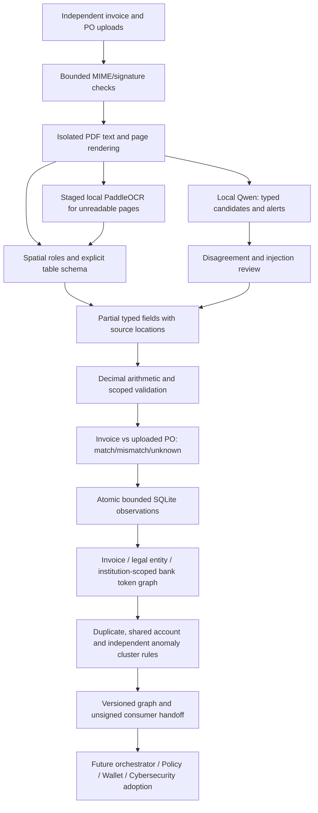

# OCR and fraud architecture

Status: OCR-owned implementation on `ocr/evidence-fraud-graph`, 10 October 2026. Shared schemas and other services are unchanged. Consumer adoption and service authentication are pending their owners.

## Module responsibilities

| Module | Interface and invariants |
|---|---|
| `ingest.py`, `worker.py` | Validate upload signatures, enforce byte/page/pixel/time bounds, isolate parsers and staged OCR from application secrets; preserve digital text and OCR only unreadable pages |
| `layout.py` | Assign explicit labels to same-page, same-source adjacent values using vertical overlap; preserve separate panels and exact source spans; recognize explicit five- and six-column table schemas and flag table-shaped unsupported layouts |
| `extract.py`, `normalize.py` | Exact English/Thai and experimental Simplified Chinese role aliases; typed nullable fields, including raw line-unit evidence; explicit locale/ISO currency/date normalization; redact observed bank accounts from every public field |
| `qwen.py` | One local, schema-constrained candidate reader with no tools, credentials or authoritative field writes; disagreement/unavailable/alert outcomes cause review |
| `validate.py`, `compare.py` | Bounded exact Decimal arithmetic, jurisdiction-scoped identifiers and exact printed PO comparisons (`invoice-po-rules-v3`); quantities/prices require matching observed units; incomplete rows/pages and unsupported financial components prevent false arithmetic allegations; partial allocation cannot hide resolved over-order terms |
| `fingerprint.py`, `history.py` | Preserve registry v1, use exact/scoped local semantic v2 and institution-scoped bank v2; atomic idempotency and duplicate detection, 500-observation cap, private SQLite metadata |
| `graph.py`, `fraud.py` | One typed graph implementation used by rules and finding-scoped export; no names-only merges or links through shared buyers; unique-code noisy-OR remains an uncalibrated signal aggregation |
| `pipeline.py`, `main.py` | Compose evidence, comparison and observation stages; bounded admission and safe errors; produce backward-compatible extraction or explicit partial pair output and additive handoff metadata |

The graph is a view of minimal observations, not another database. Its invoice → company edges are `ISSUED_BY` and `BILLED_TO`; company → bank-token edges are `PAYABLE_TO`. Export adds evidence-backed `DUPLICATE_CANDIDATE` and `SIMILAR_REFERENCE` links. Shared-account paths use issuance/payment relationships only. Suspicious clusters require distinct scoped issuers and multiple independent anomaly families; amount/math anomalies count as one family. Signals do not prove collusion, bank ownership or prior financing.

Only the current observation and nodes implicated by findings are exported. Unrelated invoice observations are omitted even when they share the same buyer or supplier. Edges carry resolvable evidence locations; neither node IDs nor evidence locations contain raw account numbers. A graph token is a sensitive local correlation identifier, not a payee address or on-chain payload.

## Extraction scope and abstention

The new spatial resolver replaces whole-row concatenation. Blank anchors can use only the immediately neighboring source segment on that row; another label cannot act as their value. Multiple conflicting observations remain unresolved. Hidden spans, AI instructions and Unicode format controls do not supply fields. Values are never recovered merely because Qwen proposed them.

Supported tables have either the exact five-column `SKU / DESCRIPTION / QTY / UNIT PRICE / LINE TOTAL` header or six-column `SKU / DESCRIPTION / QTY / UNIT / PRICE / TOTAL` header. Unknown table-shaped headers, missing/shifted cells and arbitrary vendor table formats receive `LINE_LAYOUT_UNSUPPORTED`; continuation pages without a repeated header remain unsupported. A printed amount with a currency code must agree with the document's declared ISO currency. Unlabeled supplier letterhead may be retained only as ambiguous raw evidence. Discounts, freight, duty and other unmodeled financial components force review and suppress arithmetic accusations that would ignore those components.

OCR-local invoice/PO comparison v3 emits a unit check for each aligned SKU. Quantity and unit-price checks resolve only when the observed units match after Unicode NFKC normalization, whitespace compaction and case folding. Missing units yield unknown; different units mismatch and leave the numeric comparisons unknown. No unit synonym or pack conversion is performed. The shared single-invoice schema has no unit field, so this comparison is available only in the OCR-local pair response until its owner reviews the contract. Matching quantities do not establish remaining PO capacity.

Simplified Chinese supports explicit aliases plus ISO dates, ISO currencies and source locale. Any observed Chinese script requires experimental review. Native Chinese financial numerals/dates, Traditional Chinese, handwriting and absent bank/party scope remain unverified. English is primary; Thai mark-recognition failures still abstain without fuzzy correction.

## Integration handoff

`/ocr/extract` preserves the unchanged shared required fields, with additive `fraud_graph` (`ocr-graph-v1`) and `handoff` (`ocr-handoff-v1`). `/ocr/verify` adds those fields at the outer pair level; `compatible_invoice` remains the shared projection. PO injection propagates into that projection's injection flags and caps confidence below 0.80. HTTP 200 or a non-null projection does not authorize financing.

The handoff binds an observation ID to the one or two uploaded document hashes, versions, review/injection reasons, fraud codes and score. It explicitly states `financial_authority=false`, `bank_ownership_verified=false`, and `authenticity=unsigned_service_response`. Registry fingerprint v1 and local fingerprint/bank v2 are separate namespaces. [Consumer handling](HANDOFF.md) describes the concrete adoption checklist and [examples](ARCHITECTURE_CONSUMER_EXAMPLES.json) show actual multipart outputs.

Wallet/security owners must define service authentication, freshness/replay handling, response/request binding, evidence retention and key rotation. Policy must enforce review/injection/risk rules; registry and wallet must independently enforce duplicate financing, PO allocations, verified payees and mandates. These remain owner decisions, not implemented guarantees here. No other-service imports or shared schema edits were needed.

See [the financial retest](FINTECH_RETEST.md) for the historical v2 test results and [line-unit decision](adr/0006-explicit-line-unit-comparison.md) for current v3 unit semantics. [Architecture validation](ARCHITECTURE_VALIDATION.md) and earlier artifacts retain their original measurements.
