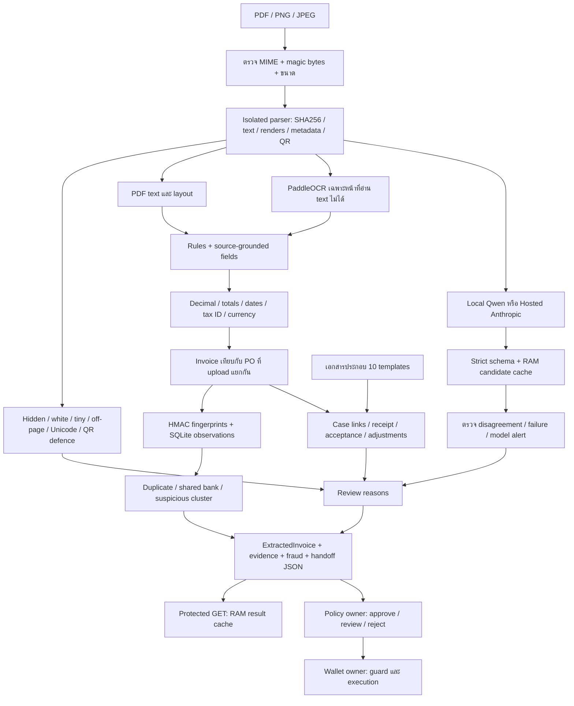

# OCR + Fraud: checklist และคู่มือ demo ล่าสุด

สถานะ 11 ตุลาคม 2026 — branch `ocr/evidence-fraud-graph`; ขอบเขต `services/ocr-ai/`, เอกสารตัวอย่างของ OCR ใน `data/invoices/`, และ `docs/05-ocr-ai.md` งานนี้เตรียม evidence ให้ Policy/Wallet; ไม่ได้ให้ OCR อนุมัติเงินเอง



## ผล checklist ทีละหมวด

| ข้อ | สถานะและหลักฐาน |
| --- | --- |
| POST PDF/PNG/JPG <=10 MB | รองรับ MIME+signature; limit จริง 10 MiB ต่อไฟล์, 5 หน้า, 12M pixels ต่อหน้า/image; เกิน limit 413 และ MIME ผิด 415 |
| `doc_hash=sha256:<hex>` raw bytes | ผ่าน tests PDF/PNG/JPEG; ไม่ใช้ hash ของ rendered image แทนต้นฉบับ |
| text, renders, QR, metadata | parser อ่านครบตามชนิด; QR/metadata/render อยู่ภายใน ไม่เผย payload/raw text ใน response และไม่เปิด URL |
| Rules ทุก shared contract fields ไม่มี cloud key | ผ่าน full response validation; ต้องมี local HMAC keys ซึ่ง setup สร้างให้; required field ขาดจะ 422 |
| มี key แล้ว LLM ทำงาน; hit ไม่เรียกซ้ำ | Hosted Anthropic adapter + local Qwen cache; mocked keyed transport และ hit ผ่าน; live hosted ยังไม่ได้ทดสอบ |
| clean PDF accuracy >=90%, aim98% | Synthetic clean 28/28 ช่อง =100%; ยังไม่ผ่านการพิสูจน์บน vendor holdout จริง; development pack header accuracy เดิม 77.59% |
| totals / dates / Thai checksum / currency | มี deterministic validators และ rejection/review tests; ไม่ใช่การตรวจทะเบียนภาษี |
| confidence / review_required | มีการคำนวณ; unresolved/mismatch/model failure ถูกส่ง review และ cap confidence ต่ำกว่า0.80 |
| hidden / white / tiny / off-page / QR / Unicode | 16/16 attack PDFs ผ่าน detection; มี metadata และ annotation ด้วย; white-on-dark header เป็น hard negative |
| ค่าถูกต้องหลัง injection / ASR0% | 0/16 attacks เปลี่ยน 7 scalar fields ที่ประเมิน; ยังไม่ครอบคลุม visual tampering ทุกแบบ |
| catch>=95%, FPR<=5% | Rules-only catch100%, hard-negative FPR0/20; ไม่ใช่ FPR ของ Qwen/cloud model |
| canonical keyed HMAC fingerprint | เก็บ recipe Registry v1 และ local scoped v2; มี HMAC tests, ไม่มี fallback key |
| ชื่อ fraud rules exact | `duplicate_invoice_hash`, `duplicate_fingerprint`, `po_amount_mismatch` อยู่ในผลทดสอบจริง |
| forged/duplicate score>=0.30, cleanต่ำกว่า | planted math/duplicate scenarios ผ่าน; invoice inflated เทียบ PO ได้0.70; ไม่ใช่ตัวตรวจลายเซ็นหรือ forgery ทั่วไป |
| fraud precision/recall>=90% | TP8/FP0/FN0/TN4 =100%/100% บน12 labelled sequences; ยังไม่ใช่ fraud corpus จริง |
| ExtractedInvoice+extras, GET by ID | ผ่าน contract tests; GET ใช้ operator token, RAM cache15นาที/500entries/8MiB, expired/restart/evicted404 |
| Policy01 approve,02 review,03/04 reject | บางส่วนผ่าน: Policy suite251ผ่าน/3skip; integrationยืนยัน injected→review และ fraud score0.70→reject, violations0. แต่ exact OCR 4-file sequenceไม่ได้ส่งครบทุกไฟล์เข้า Policy; duplicateในflowถูก Registry block และ shared contractยังไม่มี PO/graph evidence |
| eval.py metrics table + docs05 | พิมพ์ตารางแล้ว และบันทึกใน `docs/05-ocr-ai.md` กับ JSON report |
| datagen/generate.py deterministic seed | ตรวจไฟล์ทั้งหมด byte-identical เมื่อ seedเท่ากัน; polished PDFs ใช้ invariant metadata |
| demo01..04 | `data/invoices/demo/` มี happy/injected/inflated/exactduplicate+PO; generatorหลักสร้างให้ |
| Siam Fresh Pack / Mekong Basket / tax IDs | demoตรง brand/name ใน Finance และ scope; IDs0105559000000/0107559000001; Finance sign-off เป็น owner workflow |
| Fresh clone ไม่มี cloud key | `release_check.py --fresh`: local clone+OCR patch, fresh venv, install core/dev, generate, start8001, pytest/Ruff, POST+GET |
| LLM cache prewarm | actual local Qwen8requests/5hits และรอบ2ทั้งหมดhit; verification serverหยุดแล้ว ต้อง prewarm live demoใหม่ก่อนนำเสนอ |
| PR mergedตามdeadline | ยังไม่ merge; ต้อง PM review; “Sun12Oct” ไม่ตรงปฏิทิน2026 เพราะ12Octเป็นMonday |

ผล numerical ทั้งหมดเป็น synthetic data ดู [metrics](CHECKLIST_EVALUATION.json), [release checks](RELEASE_CHECK.json), [model smoke](CHECKLIST_MODEL_CHECK.json), [case loop](CASE_LOOP_RESULTS.json), [actual Policy loop](DEMO_LOOP_RESULTS.json)

## Extraction และ Fraud ทำอะไรบ้าง

Rules อ่าน invoice no., issue/due date, amount, ISO currency, supplier/buyerชื่อและtax ID, line description/qty/unit price/total โดยใช้ตำแหน่งข้อความและ labels ที่รองรับ `FieldValue` แยก present/missing/ambiguous/conflicting/unsupported พร้อม source hash, page, bbox, confidence และ evidence refs ค่าที่ขาดไม่ได้ถูกเติมจาก LLM

PDF text ใช้ก่อน; scan/image ต้องมี staged Paddle assets และเปิด `OCR_PADDLE_ENABLED=1` ไม่มีการดาวน์โหลดโมเดลระหว่าง request ภาษาอังกฤษเป็นหลัก ไทยเป็นรอง ส่วนจีน Simplified เป็น experimental และต้อง review ไม่รองรับ Traditional Chinese, native financial numerals หรือ arbitrary global vendor layouts

Hosted/local vision คืน nullable candidates ภายใต้ schema เดียวกัน ไม่มี tools การเสนอจำนวนเงินผิด เช่น0.01 เทียบกับต้นฉบับ749000.00 ทำให้ review โดยค่าหลักยัง749000.00 Hosted adapterส่ง page imagesไป Anthropicผ่านHTTPS เมื่อมี configuration; ไม่มี cloud keyใช้ rules ได้ Cacheเก็บ candidatesในRAMโดยผูกกับprovider/model/prompt/schema/images/account context; ไม่ cache failures

`doc_hash` ตรวจ bytesซ้ำ ส่วน `invoice_fingerprint` เป็น `0x`+HMAC-SHA256 ของ `v1|supplier_tax_id|buyer_tax_id|norm(invoice_no)|amount:.2f|currency|issue_date` โดย `FINGERPRINT_HMAC_KEY` Graphผูก Invoice→Supplier/Buyer และ Supplier→institution-scoped bank token; ห้ามนำ tokenไปใช้เป็นpayee address มี exact/semantic duplicate, near-duplicate, shared-account, bank-change และ multi-signal cluster rules คะแนน noisy-OR เป็น risk signal ที่ยังไม่ calibrated ไม่ใช่โอกาสเป็น fraud

## ชุดเอกสารประกอบ 12 ไฟล์

อยู่ใน `data/invoices/financing_case/` พร้อม `manifest.json` และ provenance/checksums เป็นเอกสารสมมติทุกไฟล์ตามแนวทางประเภทเอกสาร/relationshipsของ [OASIS UBL](https://docs.oasis-open.org/ubl/UBL-2.3.html) และ [Peppol Billing](https://docs.peppol.eu/poacc/billing/3.0/) ไม่ใช่การนำตราหรือเอกสารธนาคารจริงมาใช้

| Type | Fields เฉพาะที่อ่าน | การตรวจ |
| --- | --- | --- |
| invoice / purchase_order | Shared fields + parties + lines + tax basis | extraction, validators, PO cross-check, graph/fraud |
| delivery_note | Shipped Quantity, Unit | เทียบ invoice line เมื่อมี1line และunitตรง |
| goods_receipt | Received Quantity, Unit, Receipt Date | shortage/quantity mismatch และ date parse |
| buyer_confirmation | Accepted Amount, Confirmation Date, Acceptance Status | ยอดตรงinvoice, accepted/disputed claim |
| credit_note | Credit Amount, Reason | invoice/PO/party/currency links; duplicate creditไม่หักสองครั้ง |
| remittance_advice | Remitted Amount, Payment Reference | linked payment claim; ยังไม่ถือว่าsettledจริง |
| assignment_notice | Assignee, Notice Date | reference/date extraction; ไม่วินิจฉัยสิทธิทางกฎหมาย |
| company_registration | Registered Name, Registration Reference | อ่านclaim; ไม่ตรวจregistry status |
| bank_confirmation | Account Masked, Bank Institution, Account Name | รับเฉพาะmasked account; ไม่ยืนยันownership |
| beneficial_ownership | Declaration Reference | อ่านreference; ยังไม่ extract ownership percentages/natural-person graph |
| insurance_certificate | Policy Reference, Coverage Amount | อ่านclaim; ไม่ตัดสินcoverage/exclusions |

Supportingทุกไฟล์ต้องมี labels `Document Type`, `Document No`, `Invoice Reference`, `PO Reference`, `Supplier Tax ID`, `Buyer Tax ID`, `Currency` ลิงก์หาย/ไม่ตรง/unsupported ชัดเจน ไม่ดัดแปลงให้เป็นinvoice รองรับเฉพาะlabelled English digital PDFs เหล่านี้ เอกสารฉบับจริงรูปแบบอื่นต้องมี extractor/evaluationเพิ่มเติม

Profile `goods_receivable_demo` ต้องมี Invoice, PO, Delivery, Receipt, Buyer confirmation เอกสารชนิดอื่นเป็น evidenceเพิ่มเติมในdemo profileนี้ ไม่ใช่เอกสารบังคับสากลสำหรับทุกการกู้ [Document catalog](DOCUMENT_CATALOG.md) อธิบายเอกสารทางธุรกิจและแหล่งverificationที่กว้างกว่าtemplateนี้

Caseตรวจ reference/IDs/currency, quantity+unit และ buyer acceptance claims; ยอดตัวอย่าง749000-credit10000-remitted50000=689000.00 เป็น `declared_balance` เท่านั้น Unknown issuer authenticityทำให้caseทุกชุดต้องreview ไม่ใช่การอนุมัติสินเชื่อหรือ ledger การเงิน

## Request และ automation

```text
POST /ocr/extract       multipart: file
POST /ocr/verify        multipart: invoice_file, po_file
POST /ocr/cases/verify  multipart: manifest (JSON string), files (repeated)
GET  /ocr/invoices/{id} header: X-OCR-Result-Token
POST /ocr/llm/prewarm   multipart: file; same operator-token header
```

Case manifestระบุfilename/typeเท่านั้น ค่าที่ตรวจต้องอ่านจากเอกสาร ไม่เชื่อค่าจากmanifest ตัวอย่างย่อ:

```json
{"profile":"goods_receivable_demo","documents":[{"filename":"invoice.pdf","document_type":"invoice"},{"filename":"purchase_order.pdf","document_type":"purchase_order"}]}
```

ตัวอย่างนี้จะได้missing supporting-document reasons ใช้manifestในชุด12ไฟล์สำหรับdemoเต็ม Limitsคือ12files/20MiBรวม และ10MiBต่อไฟล์ Errorsใช้FastAPI `detail` พร้อม422/413/415/429/503ตามเหตุการณ์

จาก `services/ocr-ai/`:

```bash
.venv/bin/python scripts/setup_local.py
.venv/bin/python datagen/generate.py --font ../../data/invoices/fonts/NotoSansThai-Regular.ttf --seed 20261001
.venv/bin/python scripts/release_check.py --fresh
.venv/bin/python scripts/release_check.py --strict
.venv/bin/python scripts/model_check.py
.venv/bin/python scripts/prewarm_llm.py
```

Generatorค่าdefaultเขียนregression fixturesลงtemporary path เพื่อไม่คืนไฟล์เก่าเข้repo; ใช้ `--output` เมื่อจะสร้างpackในตำแหน่งเฉพาะ Demo/financing packอยู่ในrepoแล้ว Setupสร้างHMAC keysและresult tokenแบบprivate ไม่พิมพ์keys Existingsettingsคงเดิมและเพิ่มtokenเฉพาะเมื่อยังไม่มี

`release_check` ทดสอบoffline extraction, fraud/injection metrics, case scenarios และHTTPไปยังPolicyจริง `--strict` ให้exit1เมื่อguardของPolicyยังผิด จึงเหมาะเป็นrelease gate `model_check` ใช้Paddle assets+Qwenจริงแบบtemporaryserverและstate ปิดprocessหลังจบ ส่วน `prewarm_llm` ใช้กับserverที่จะdemoจริง ไม่เพิ่มhistoryและเก็บsanitizedJSON RAM cacheหายเมื่อrestart/ครบ15นาที และหลายworkersอาจไม่hitเดียวกัน

## Handoff ที่ยังต้องทำกับเจ้าของแต่ละฝั่ง

Policy guardsสำหรับ injection→review และ fraud>=0.30→reject ผ่าน integration แล้ว; Policy suite 251 tests ผ่าน/3 skipped. ยังต้องทดสอบconfidence guardกับการส่ง evidence ตาม contract ที่ review แล้ว เพราะ Orchestrator ปัจจุบันส่ง invoice projection ไม่ใช่ pair/case/graph bundle. Registryตรวจ repeat registrationได้ แต่ไม่พิสูจน์ prior financingทุกแห่ง. Wallet/Cybersecurity ต้องตรวจ authentication, tenant context, signed handoff, mandate/payee และ execution guardsตามหน้าที่ของตน OCRไม่แก้ owner codeเพื่อทำให้ผล test ดูผ่าน

งานresearchถัดไปคือvendor-labelled holdoutแยกsupplier/layout, line-table variations, native Chinese invoices, Thai scans, visual tampering และlabelled benign/fraud corpusจริง รวมถึงverified buyer/bank/registry/signature sources [DocILE](https://github.com/rossumai/docile) ใช้ศึกษาextraction/line itemsได้ แต่ไม่ใช่fraud labelsหรือหลักฐานfinancing eligibility

## ตรวจลำดับ demo จริง

ชุด `data/invoices/demo/` ถูก replay ตามลำดับเดียวกันบน state ชั่วคราว เพื่อพิสูจน์ทั้งผลรายไฟล์และผลที่เกิดจากประวัติการรับเอกสาร:

| ไฟล์ | Expected evidence gate | สิ่งที่ต้องเห็น |
| --- | --- | --- |
| `01_happy.pdf` | approve candidate | คะแนน fraud ต่ำกว่า 0.30, ไม่มี injection และไม่ต้อง review |
| `02_injected.pdf` | review | `VISIBLE_INSTRUCTION`, review required; เลข 0143 ไม่ซ้ำ happy invoice 0142 |
| `03_inflated.pdf` | reject | `math_inconsistent`, fraud score 0.40; เลข 0144 แยกจากอีกสองใบ |
| `04_duplicate.pdf` | reject | byte-identical กับ 01 และแสดง `duplicate_invoice_hash` กับ `duplicate_fingerprint`, fraud score 0.96 |

ผลทั้ง 4 รายการผ่านใน [ordered demo report](DEMO_ORDER_CHECK.json) ด้วย `.venv/bin/python scripts/demo_order.py`; `release_check.py --fresh` เรียก loop นี้ให้อัตโนมัติด้วย การทดสอบนี้ยืนยัน OCR evidence gate โดยไม่เรียก Policy endpoint ส่วน [actual Policy integration result](DEMO_LOOP_RESULTS.json) ยืนยัน injected→review และ fraud score0.70→reject โดยมี 0 control violations; ยังไม่ได้ส่ง exact OCR 4-file sequence เข้า Policy ครบทั้งชุด และ duplicate ถูก Registry block ก่อนถึง Policy

การปิดท้าย release run ผ่านทั้ง working environment และ local clone ที่ติดตั้ง core/dev dependencies ใหม่โดยไม่มี cloud API key: OCR 184 tests ผ่านทั้งสองที่, Policy 251 ผ่าน/3 skipped, Ruff check/format และ pip check ผ่าน, fixtures สร้างได้, และ clean clone เริ่ม server บน port 8001 แล้วผ่าน `POST /ocr/extract` กับ protected `GET /ocr/invoices/{id}`. Release report ปัจจุบันบันทึก `ocr_checks_passed=true`, `release_ready=true`, และ 0 Policy control violations. ใช้ [release report](RELEASE_CHECK.json) ตรวจรายละเอียดของแต่ละขั้น

PRสำหรับPM review: [ReceivableOS PR16](https://github.com/Khawpuneiei/ReceivableOS/pull/16) ยังไม่ merge
