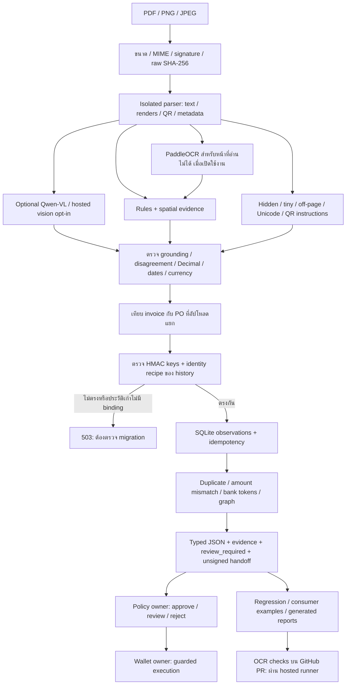

# Progression Update — OCR + Fraud Detection

วันที่ 2026-10-11 · สถานะ: ส่ง PR ให้รีวิวแล้ว ยังไม่มี approval/merge รอบใหม่

งานของเราครอบคลุมการอ่าน invoice/PO, OCR injection defence, ตรวจความสอดคล้องข้ามเอกสาร และ fraud signals พร้อมหลักฐาน ระบบส่งข้อมูลให้ Policy/Wallet แต่ไม่ตัดสินใจปล่อยเงินเอง รอบนี้แก้ความปลอดภัยของประวัติ duplicate และความถูกต้อง/การรันซ้ำของรายงาน พร้อมเสนอ CI แยกจากงาน OCR ตาม ownership ของทีม

## ผังระบบและขอบเขตเจ้าของ



Invoice text และ model output เป็นข้อมูลที่ไม่เชื่อถือ Qwen/hosted candidates ไม่สามารถแทนค่าที่ไม่มีหลักฐานได้ Graph, confidence และ HTTP 200 ไม่ใช่การรับรองเอกสารหรือสิทธิ์จ่ายเงิน

## สิ่งที่ทำเพิ่มจากรอบก่อน

| งาน | ก่อนแก้ | หลังแก้ / ผลกระทบ |
|---|---|---|
| History context — PR #40 | เปลี่ยน fingerprint key แล้วใช้ SQLite เดิม: re-saved duplicate หลุดจาก duplicate_fingerprint เหลือ shared_bank_token / fraud 0.15 | ผูก history กับ digest ของ key settings และ identity recipe; mismatch หรือ populated unversioned DB →503 ก่อน replay/write; ไม่ล้างประวัติอัตโนมัติ |
| Evaluation denominators — PR #41 | เอกสารอ่านล้มเหลวหายจากตัวหาร และ missing counts อาจถูกนับเป็นเอกสารครบ | Expected header/line counts ถูกเก็บก่อน extract; failed documents นับเป็นผิด; partial run exit nonzero |
| Consumer automation — PR #41 | รัน core checkout ได้สามกรณีแล้วพัง เพราะ corpus ถูกแยกออก | สร้าง fixtures ใน temporary storage แล้วรันครบห้ากรณี; ปิด hosted calls แม้ shell มี key/opt-in |
| Handoff documentation — PR #41 | ลิงก์ JSON snapshots ไม่อยู่ใน Git และ graph version ในเอกสารเก่า | ให้คำสั่ง regenerate และแก้ version เป็น ocr-graph-v2 |
| CI — PR #42 | PR ไม่มี workflow สำหรับ OCR | เสนอ workflow 54 บรรทัด: install, pip check, Ruff, pytest, consumer evidence, ordered demo; ไม่ใช้ cloud key หรือ model downloads |

Regression ของ evaluator ใช้หนึ่ง readable และหนึ่ง failed document: หลังแก้รายงาน header/line accuracy 50% และ complete document หนึ่งใบ การทดสอบนี้ยืนยันวิธีนับคะแนน ไม่ใช่ตัวเลข OCR accuracy บนข้อมูลจริง

## ฟังก์ชันที่มีอยู่และข้อจำกัด

| ส่วน | หน้าที่และพฤติกรรม |
|---|---|
| Ingest / worker | รับ PDF/PNG/JPEG ไม่เกิน 10 MiB; hash raw bytes; แยก parser/OCR process และจำกัด resource; ไม่ตาม document links หรือรัน embedded code |
| Extraction | อ่าน text layer ก่อน; staged Paddle สำหรับ unreadable pages; คืน parties, invoice number, dates, money/currency, line items และ evidence; missing/conflicting required shared fields →422 |
| Validation | Decimal และเงินเป็น JSON string; ตรวจ arithmetic, dates, currency, Thai tax-ID checksum และ ambiguity; review_required เป็นข้อมูลให้ downstream ตัดสินใจ |
| Injection | ตรวจ text visibility/geometry, instruction patterns, Unicode และ QR; suspicious content ไม่เป็น model instructions และไม่เติม authoritative fields |
| Invoice/PO | เทียบ parties/currency/amount และ SKU/quantity/unit/price จากสองแหล่ง; missing evidence เป็น unknown; ไม่มี unit/pack conversion หรือ PO capacity ledger |
| Fingerprint | Registry v1 เป็น HMAC ของ canonical fields; strip zeros ต่อ numeric run ก่อนตัด separators; local semantic v2 และ bank:v2 แยก namespace/jurisdiction |
| History | SQLite สูงสุด 500 observations, mode 0600; retries ผูก route/bytes; changed bytes ภายใต้ key เดิม →409; context guard ไม่เปลี่ยน Registry fingerprint formula |
| Fraud / graph | exact byte/semantic duplicates, arithmetic, PO mismatch, scoped shared-bank/changed-payee และหลาย independent anomalies; คะแนนเป็น rule aggregation ไม่ใช่ probability |
| Supporting cases | อ่านสิบ labelled English templates และความสัมพันธ์กับ invoice/PO; authenticity ยัง unknown และทุก case ต้อง review; ไม่ใช่ general bank-statement/KYC verification |
| Results / prewarm | GET และ prewarm ใช้ operator token; bounded RAM cache/TTL; ไม่ใช่ tenant authentication; restart ล้าง RAM cache |
| Models | English เป็นหลัก, Thai รอง, Chinese experimental/review-only; default ไม่เปิด models; scan/image extraction ต้องมี local OCR ที่พร้อมใช้งาน |

ข้อจำกัด parser ปัจจุบัน: 5 PDF pages, 12M pixels/page, 200k text characters, parser timeout 20s และสอง processing slots ต่อ process ไม่มีการอ้างว่า deployment นี้รองรับ multi-tenant production แล้ว

## Demo: mock → extract → recheck → fraud/Policy → JSON

1. Datagen สร้าง fictional invoice/PO และ clean/attack/duplicate cases; source files ใช้ reproducible seed/layout การเปลี่ยน UUID/runtime state ไม่ถูกนับเป็นความแม่นยำ
2. ส่ง multipart เข้า POST /ocr/extract หรือ POST /ocr/verify; ตรวจ typed response, source hashes และ required fields
3. Recheck grounding, money/date/currency, PO checks และ injection flags
4. Fraud rules ตรวจ observations; actual Policy loop ตรวจ guard; Registry ตรวจ repeated flow
5. เก็บ JSON ใต้ services/ocr-ai/docs/ ซึ่ง Git ignore; ส่ง schema/provenance/ข้อจำกัดให้เพื่อน ไม่ commit generated evaluation reports

| Demo ตามลำดับ | Fraud score | ผลที่คาดตาม Policy guard |
|---|---:|---|
| 01 happy ใน isolated state | 0.00 | approve หากผ่าน profile/Policy rules อื่น |
| 02 injected | 0.00 + injection flag / confidence 0.79 | review |
| 03 inflated | 0.40 | reject |
| 04 re-saved duplicate หลัง 01 | 0.80 | reject; different doc_hash / same fingerprint |

Exact-byte duplicate แยกทดสอบ: ทั้ง duplicate_invoice_hash และ duplicate_fingerprint →0.96. Legacy text demo ที่ PM ยังใช้ถูกคืนเหมือน main; รองรับเฉพาะ exact allowlisted bytes ใน development mode และไป review เพราะ evidence ไม่ครบ

## ผลทดสอบและความหมายของตัวเลข

| ชุดตรวจ | ผลล่าสุดที่ยืนยัน | Scope |
|---|---|---|
| Core #16 release | 184 passed / 1 skipped ทั้ง local และ fresh environment | Install/generate/start 8001/extract/protected GET/Ruff/pip check; ไม่มี cloud key |
| History guard #40 | 196 passed / 1 skipped | key/recipe drift, legacy state, restart, retry, reset permission, opaque metadata |
| Evidence #41 | 199 passed / 1 skipped | Full OCR suite; final reporting regressions 3/3 |
| Hosted CI #42 | 199 passed / 1 skipped; install/pip/Ruff ผ่าน | Ubuntu 24.04, Python 3.11; consumer 5/5, ordered demo 4/4; models ปิด |
| Consumer API examples | 5/5 | Actual multipart requests; typed partial/shared projections; Chinese ต้อง review; ไม่มี hosted inference |
| Strict Policy integration | 7/7, 0 control violations | Synthetic local mock flow; ไม่ใช่ successful funding |
| Ordered OCR demo | 4/4 | Evidence gate; actual Policy loop เป็นคนละการตรวจ |
| Clean scalar fields / injection | 28/28; catch 4/4; attack success 0/4; false alerts 0/6 | ชุด generated development/regression ขนาดเล็ก |
| Planted fraud sequences | TP8 / FP0 / FN0 / TN4 | Synthetic scenarios; ไม่ใช่ production precision/recall |
| Peer suites บน main 7d46da5 | Policy 251 passed / 3 skipped; Wallet 122 passed / 2 skipped | ผล peer retest ก่อน follow-up reporting; ไม่ได้แก้ peer code |

หนึ่ง test ที่ข้ามต้องใช้ optional publisher corpus ใน PR #39 ซึ่ง companion coverage เดิมผ่าน 13/13. [Hosted GitHub CI run 38149105595](https://github.com/Khawpuneiei/ReceivableOS/actions/runs/38149105595) จบ success: suite ใช้ 185.58s; pipeline ทั้งหมดประมาณสี่นาที. CI นี้ไม่ติดตั้ง Paddle/Qwen weights และไม่ได้เรียก actual Policy/Wallet; strict peer loop 7/7 เป็นผล local แยกต่างหาก

## สถานะ PR และลำดับ merge

| PR | เนื้อหา | Base / สถานะ |
|---|---|---|
| [#16](https://github.com/Khawpuneiei/ReceivableOS/pull/16) | Core OCR/Fraud + fixes ของรีวิวทั้งสองรอบ | main; open / รอ owner review; size ยังต้องให้ PM ยอมรับ |
| [#39](https://github.com/Khawpuneiei/ReceivableOS/pull/39) | Optional corpus, attribution และ experiment evidence | #16 branch; draft |
| [#40](https://github.com/Khawpuneiei/ReceivableOS/pull/40) | History context guard, 197 changed lines | #16 branch; open |
| [#41](https://github.com/Khawpuneiei/ReceivableOS/pull/41) | Correct/reproducible evidence reporting, 221 changed lines | #40 branch; open |
| [#42](https://github.com/Khawpuneiei/ReceivableOS/pull/42) | OCR CI, 54 lines / one workflow; hosted run ผ่าน | #41 branch; open; PM-owned repo workflow แยก review |

ลำดับ implementation: #16 →#40 →#41 →#42 แล้ว retarget แต่ละ PR ไป main เมื่อ parent merge. #39 รอ core ก่อนเช่นกัน Progression document นี้เป็น docs-only follow-up ของ #16 ไม่มีการ push/merge main และยังไม่ถือว่า reviewer ปิด blockers

## สิ่งที่ยังต้องทำร่วมกับทีม

- Core #16 แม้แยก corpus/reports แล้ว ยัง 90 files / ประมาณ 10.4k added lines; PM ต้องตัดสิน retained scope หรือขอแบ่ง implementation เพิ่ม
- Clean flow ปัจจุบันถึง Policy approve แต่ Wallet blocked / SchemaInvalid; PM ต้องส่ง execute intent/fingerprint และเชื่อม Registry registration/credit approval ไม่ bypass guard
- Typed PO/case/graph evidence ยังไม่อยู่ใน shared Policy contract; ตัวอย่างและ regression ของเราเป็น preparation สำหรับ PM/Policy/Wallet adoption ไม่ใช่การยืนยันว่า downstream ใช้ fields เหล่านั้นแล้ว
- PM พิจารณาให้ OCR checks เป็น required status หลัง workflow ผ่าน; ยังไม่เปลี่ยน branch rulesets. Workflow ไม่มี path filters เพื่อให้ required check ไม่ค้างบน PR ของส่วนอื่น ดู [GitHub workflow events](https://docs.github.com/en/actions/reference/workflows-and-actions/events-that-trigger-workflows)
- ผู้ใช้ยืนยันว่ารอบนี้ยังไม่มี real invoices พร้อมสิทธิ์และ independent labels: ใช้ชุดตัวอย่างเดิม/เครื่องมือก่อน; vendor-heldout accuracy และ adjudicated fraud labels ยังเปิดอยู่ ห้ามเรียก publisher/generator data ว่า independent holdout
- ยังไม่มี live hosted-model benchmark, bank/payee ownership attestation, verified issuer signature หรือ real settlement; ไม่อ้างว่า Paddle เหนือ Qwen ในทุกภาษา

## วิธีรันซ้ำจาก checkout ที่มี PR #41

จาก services/ocr-ai หลังติดตั้ง requirements-dev.txt ตาม README:

```bash
PYTHONPATH=../.. .venv/bin/python -m pytest -q
.venv/bin/python -m ruff check .
.venv/bin/python -m ruff format --check .
.venv/bin/python scripts/consumer_review.py
.venv/bin/python scripts/demo_order.py
# สำหรับ actual peer loop ต้องติดตั้ง requirements-integration.txt ก่อน
.venv/bin/python scripts/demo_loop.py --strict --skip-fraud-eval
```

History ที่มีข้อมูลจากก่อน guard จะถูกปฏิเสธเพราะไม่มี binding: หยุด service, เก็บฐานเดิม และวางแผน migration/re-extraction กับ owners. เฉพาะ fictional demo เท่านั้นที่ใช้ fresh state หรือ explicit development reset ตาม [README](../README.md) ไม่มีการ reset ข้อมูลผู้ใช้ในรอบงานนี้

อ่านต่อ: [review fixes](REVIEW_FOLLOWUP.md), [architecture](ARCHITECTURE.md), [consumer boundaries](HANDOFF.md), [Policy integration](POLICY_INTEGRATION_HANDOFF.md). Raw model/global-layout limitations และ research access protocol อยู่ใน companion corpus/evidence PR ไม่ได้ปิดด้วยคะแนน regression
