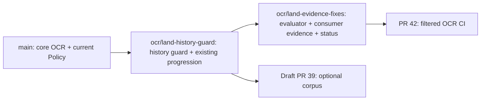

# OCR/Fraud status — 12 October 2026 (Bangkok)

This is a deployment and review follow-up to the [11 October Progression Update](PROGRESSION_UPDATE_2026-10-11.md). That report is historical; its open-PR status and unfiltered-CI recommendation have been superseded.

## What is actually on main

The inspected main revision is `fd5a323`: core OCR/Fraud PR #16 and Policy mandate compiler PR #31 have merged. No new review comments were found on OCR #16, #40, #41 or #43 at this check.

GitHub marks #40, #41 and #43 as merged, but their destinations were feature branches:

| PR | Destination | Present on inspected main? |
|---|---|---|
| #16 — core OCR/Fraud | main | Yes |
| #40 — history context guard | ocr/evidence-fraud-graph | No |
| #41 — reproducible evaluation/consumer evidence | ocr/history-context-guard | No |
| #43 — progression document and README link | ocr/evidence-fraud-graph | No |
| #42 — OCR CI | open PR, now based on ocr/land-evidence-fixes | No |
| #39 — optional corpus/experiments | draft, based on core feature branch | No |

Merged into a feature branch does not mean shipped to main. The follow-up branches below preserve those reviewed commits and add current main through ordinary merges, with no force push or direct main writes.

## Follow-up merge route

1. Review [history landing PR #45](https://github.com/Khawpuneiei/ReceivableOS/pull/45) against main (335 changed lines, preserving #40/#43).
2. Review the evidence landing PR against the history branch (preserving #41 plus this status update); after the parent merges, retarget it to main.
3. Review #42 against the evidence branch; after the parent merges, retarget it to main. The workflow remains a separate PM-owned root change.
4. Optional corpus #39 is not required to run the core demo. It remains draft and should be reviewed separately with attribution preserved.

Existing populated histories without a matching context binding fail closed after the guard lands. Preserve the database and plan migration/re-extraction; only fictional demo history may use the explicit development reset. Do not silently clear real records or switch keys mid-rehearsal.

## CI review addressed

[The new PM comment on #42](https://github.com/Khawpuneiei/ReceivableOS/pull/42#issuecomment-6115993203) requests path filters and explicit root ownership. The workflow now filters both pull requests and main pushes to `services/ocr-ai/**`, `data/invoices/**`, `shared/**`, and `.github/workflows/ocr-ci.yml`; manual dispatch remains available. YAML and included/excluded example paths were checked.

The PR description explicitly requests PM sign-off for `.github/workflows/`. Permissions remain contents:read, actions are SHA-pinned, checkout credentials are not persisted, and hosted/Paddle/Qwen readers are off.

Do not make this path-filtered job an unconditional required check for all PRs: skipped workflows can leave required checks pending. A future always-running aggregate gate needs a separate PM decision. See [GitHub workflow path-filter documentation](https://docs.github.com/en/actions/reference/workflows-and-actions/workflow-syntax#onpushpull_requestpull_request_targetpathspaths-ignore). No branch ruleset was changed.

## Revalidation against current main

The run uses the combined OCR landing checkout and current main's actual peer services. Generated JSON evidence stays local and ignored; fixtures and state are temporary.

| Check | Result |
|---|---|
| Full OCR suite | 199 passed / 1 optional-corpus skip, 140.67s |
| Ruff lint / format | Passed, 80 Python files formatted |
| Consumer multipart API cases | 5/5: complete, missing-required, mismatch, international, experimental Chinese |
| Ordered PDF demo | 4/4: expected evidence gates approve, review, reject, reject |
| Actual local Policy/Registry loop | 7/7; zero Policy control violations |
| Synthetic field/injection/fraud evaluation | Clean fields 28/28; injection catch 16/16; changed-field attack success 0/16; hard-negative alerts 0/20; planted fraud TP8 / FP0 / FN0 / TN4 |
| Updated hosted CI #42 | Success on revision 059c946: 199 passed / 1 optional-corpus skip; install/pip/Ruff, consumer 5/5 and demo 4/4 |

The updated [GitHub run 38202715935](https://github.com/Khawpuneiei/ReceivableOS/actions/runs/38202715935) passed on Ubuntu 24.04 / Python 3.11; it does not execute the peer Policy/Wallet loop.

The local clean flow still reaches Policy approve and Wallet blocked / SchemaInvalid. The PM/Wallet owners must align execution intent/fingerprint, Registry registration and credit lifecycle. OCR does not bypass Wallet guards or change peer implementations. Wallet PR #44 is open and not used here.

## Remaining evidence boundaries

No permissioned, independently labelled real invoice set is available; the user chose existing examples plus evaluation tooling. All scores above are synthetic regression evidence, not real fraud calibration or global vendor accuracy. English is primary; Thai scan extraction has known gaps; Simplified Chinese remains experimental and review-only. This CI does not benchmark live Paddle/Qwen/hosted inference or prove real settlement.

For commands and API/function details, use the [service README](../README.md), [architecture](ARCHITECTURE.md), [consumer handoff](HANDOFF.md) and [historical progression](PROGRESSION_UPDATE_2026-10-11.md). No shared schema, Policy, Wallet, orchestrator or peer fixture was edited by these follow-ups.
